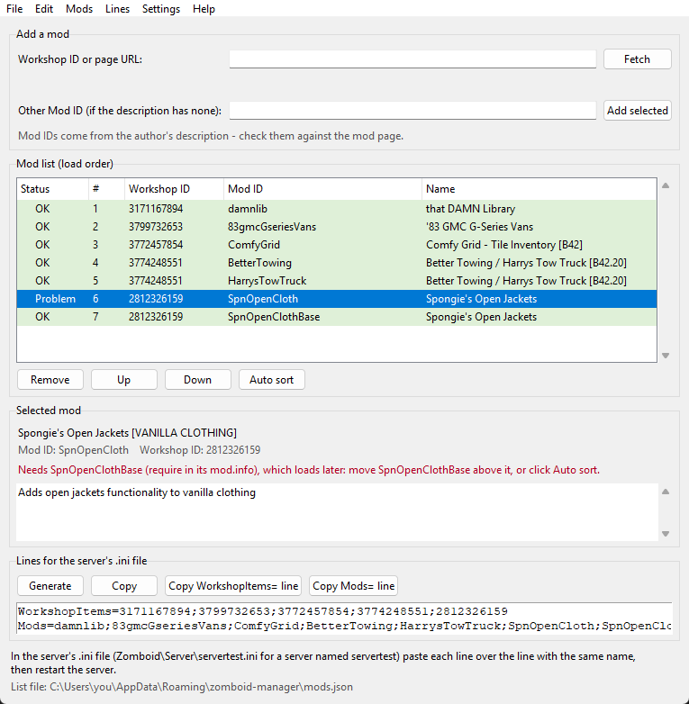

# zomboid-manager — mod list manager for Project Zomboid servers

**zomboid-manager** is a free Windows tool for people who run a **Project Zomboid dedicated server**. It keeps your
server's mod list, checks the mods for conflicts and missing requirements, sorts the **load order**, and writes the
two lines your server needs — `WorkshopItems=` and `Mods=` — ready to paste into the server's `.ini` file.

[**⬇ Download zomboid-manager for Windows**](https://github.com/reylukakozlowski/zomboid-manager-releases/releases/latest/download/zomboid-manager-win-Setup.exe)
· [All files of the latest release](https://github.com/reylukakozlowski/zomboid-manager-releases/releases/latest)



## What it does

- **Add a mod from the Steam Workshop** by its Workshop ID or page address: the program reads the mod's title and
  suggests the Mod IDs from the author's description. Tick the ones you want.
- **Checks every mod against its own `mod.info`** (the files Steam downloaded to your PC): a green row is fine, a red
  row has a problem — a conflict (`incompatible`), a required mod that is missing (`require`), a wrong order
  (`require`, `loadModAfter`, `loadModBefore`) or a Mod ID that the Workshop item does not have. The panel under
  the list says why and what to do.
- **Auto sort** puts the mods in a working load order: what each `mod.info` asks for first, then libraries on top,
  regular mods, patches lower, vehicle mods at the bottom. One click, and **Undo** brings the old order back.
- **Writes the server lines** without duplicates or typos: `WorkshopItems=` (each Workshop item once) and `Mods=` in
  your order. Copy both, or each one on its own.
- **Imports the lines of an existing server** (*File → Import server lines*), so you start from the mods you
  already run.
- Saves a list to a file and opens it again, and keeps the last 10 changes for **Undo / Redo**.

## Install

1. [Download `zomboid-manager-win-Setup.exe`](https://github.com/reylukakozlowski/zomboid-manager-releases/releases/latest/download/zomboid-manager-win-Setup.exe)
   and run it.
2. It installs for your Windows user only — **no administrator rights** — and adds shortcuts to the Start menu and
   the desktop.
3. Windows SmartScreen may say **"Windows protected your PC"** because the program is not code-signed. Choose
   **More info**, then **Run anyway**. Check the download first, as below.

Requirements: 64-bit Windows 10 or 11 (developed and tested on Windows 11). Python is not needed; it is inside the
program.

**Updates:** the program asks this page for a newer version when it starts (you can turn that off in
*Settings*) and on *Help → Check for updates*. It downloads an update only when you click **Update**, then restarts;
your mod list stays.

## Is it safe?

- **Check the download.** GitHub shows the SHA-256 of every file on the
  [release page](https://github.com/reylukakozlowski/zomboid-manager-releases/releases/latest). In PowerShell:

  ```powershell
  Get-FileHash .\zomboid-manager-win-Setup.exe
  ```

  The `Hash` it prints must be the same as the one GitHub shows (GitHub writes it in lower case, PowerShell in
  upper case — only the letters' case may differ). If it is not the same, do not run the file.
- **What it changes on your PC:** the program goes to `%LocalAppData%\zomboid-manager`; your mod list and settings
  live in `%APPDATA%\zomboid-manager` (`mods.json`, `settings.json`). Nothing else.
- **What it connects to, and only then:**
  - Steam's public Web API (`api.steampowered.com`) when you click **Fetch** — to read a mod's title and
    description. No Steam account or key.
  - GitHub (this repository) to look for a newer version.
  - Your web browser opens the Steam Workshop when you choose *Open Workshop page* or *Search Workshop for the name*.
- **What it never does:** it does not connect to your server, does not change your server's files (you paste the
  lines yourself), does not change your mods (it only reads the `mod.info` files Steam downloaded), and sends no
  usage data — there is no telemetry and no account.
- Antivirus programs sometimes flag programs built with PyInstaller by mistake. If yours does, compare the SHA-256
  as above and report the false positive to your antivirus vendor.
- Found a security problem? Please follow the [security policy](SECURITY.md) and report it privately.

## Quick start

1. **Add mods:** paste a Workshop ID (e.g. `3171167894`) or the mod's Steam page address into *Workshop ID or page
   URL*, click **Fetch**, tick the Mod IDs you want, click **Add selected**.
2. **Fix the order:** red rows tell you why they are red. Click **Auto sort** — or move rows with **Up** / **Down**.
3. **Put the lines on the server:** click **Generate**, then **Copy**. In your server's `.ini` file
   (`Zomboid\Server\servertest.ini` for a server named `servertest`, usually under your user folder) paste each line
   over the line with the same name, save, and restart the server.

Already running a server? Use *File → Import server lines*, paste its `WorkshopItems=` and `Mods=` lines (or the
whole `.ini` file), and the list fills in.

## Uninstall

Windows **Settings → Apps**, find **zomboid-manager**, choose **Uninstall**. Your mod list stays in
`%APPDATA%\zomboid-manager`; delete that folder too if you do not need it any more.

## Feedback

- Something does not work, or you have an idea? [Open an issue](https://github.com/reylukakozlowski/zomboid-manager-releases/issues/new/choose).
- This repository holds the releases only (the newest one); the source code is private for now.

## Licence

zomboid-manager is free software under the [MIT licence](LICENSE). It is built with Python, Tcl/Tk and Velopack;
their licences come with the program, in the `licenses` folder next to `zomboid-manager.exe`.

zomboid-manager is a fan-made tool, not affiliated with or endorsed by The Indie Stone or Valve. Project Zomboid is
a trademark of The Indie Stone; Steam is a trademark of Valve Corporation.
